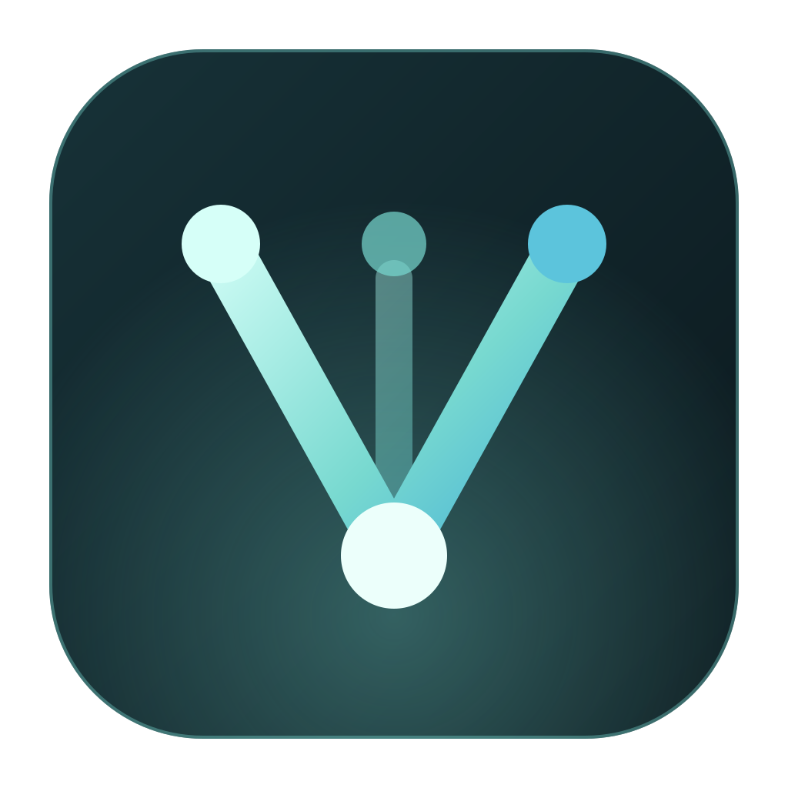
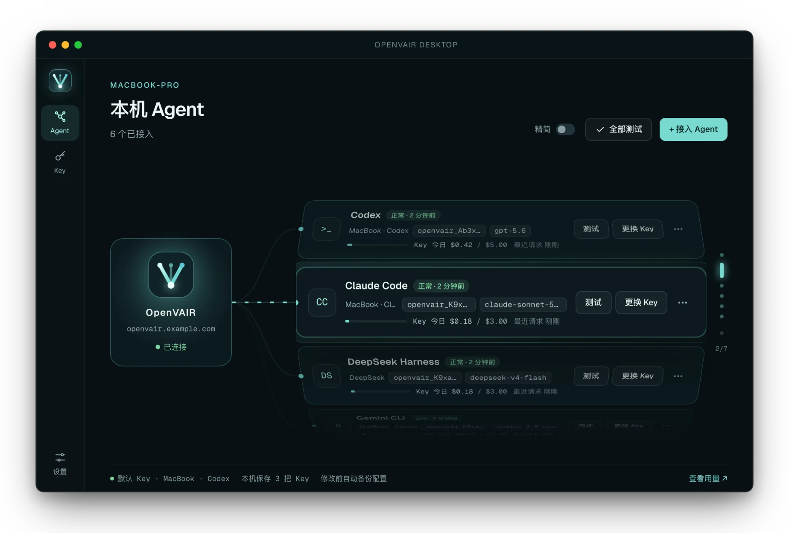
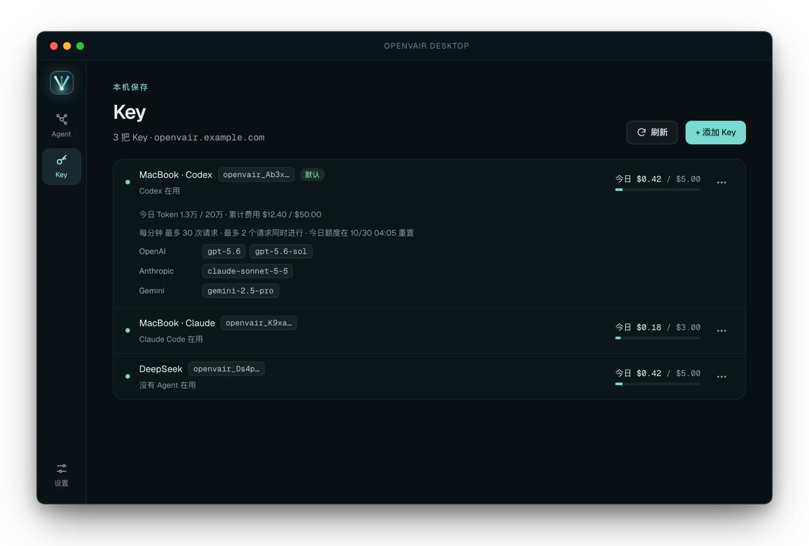

<div align="center">



# OpenVAIR

**One command to deploy. Paste a key and you're set.**

A self-hosted AI gateway for teams: Claude Code, Codex, Gemini CLI and other coding agents run on your own model channels.

[](LICENSE)
[](client/LICENSE)


**English** · [中文](README.md)

[Quick start](#quick-start) · [Desktop client (Chinese)](client/README.md) · [Deployment and operations](docs/self-hosting.en.md) · [Comparison with other projects](docs/comparison.en.md)

<br>



</div>

## Features

- **One-command install**: prebuilt image, secrets generated automatically, admin set up in a browser wizard.
- **Few concepts**: single tenant, one admin. No sign-ups, members, roles or top-ups.
- **Secure by default**: encrypted upstream keys, SSRF checks, Secure cookies and security headers on by default.
- **Paste a key and go**: OpenVAIR Desktop configures Codex, Claude Code, Gemini CLI and other agents in one click, tests them, and restores the original config on disconnect.
- **A key per person**: limit each key's channels, models, quota, rate and concurrency; disable or revoke any time.
- **Any channel**: official APIs, relays or internal services speaking OpenAI, Anthropic, Gemini or compatible protocols, exposed via all three protocols.
- **Automatic failover**: on errors or rate limits, requests move on by priority; the failing channel cools down.
- **Channel monitoring**: scheduled availability and quality checks can lower a channel's priority or pull it.
- **Easy to debug**: request details show the channels tried, why they failed and where time went.
- **Clear usage**: requests, tokens and cost by key, model and channel; bodies are never stored. Holders check their own usage in the client, no account needed.

<div align="center">

</div>

## Quick start

**① Install the server** (requires Docker and Docker Compose v2)

```bash
curl -fsSL https://raw.githubusercontent.com/OpenVAIR2026/openvair/main/install.sh | sh
```

The script installs to `~/openvair` and prints the URL and setup token. Run it again to upgrade.

**② Add channels and keys**

Open <http://localhost:8080/setup> (or the printed URL) to set up the admin, add upstream channels, and create an API key per teammate.

**③ Teammates connect**

In [OpenVAIR Desktop](https://github.com/OpenVAIR2026/openvair/releases), enter the server URL and key, pick agents, and click **Connect** (接入).

> [!IMPORTANT]
> **Back up your `MASTER_KEY`.** Without it, channel keys can't be decrypted:
> `cd ~/openvair && docker compose exec openvair cat /run/openvair/master_key`

<details>
<summary><b>Build from source</b></summary>

```bash
git clone https://github.com/OpenVAIR2026/openvair.git
cd openvair
OPENVAIR_IMAGE=openvair:local docker compose up -d --build
```

</details>

<details>
<summary><b>LAN and public deployment</b></summary>

LAN: `http://<server-ip>:8080`. Public: a domain behind an HTTPS reverse proxy. See [Deployment and operations](docs/self-hosting.en.md).

</details>

## Call it without the client

```bash
curl http://localhost:8080/v1/chat/completions \
  -H 'Authorization: Bearer openvair_...' \
  -H 'Content-Type: application/json' \
  -d '{"model":"your-model","messages":[{"role":"user","content":"hello"}]}'
```

The key can go in `Authorization: Bearer`, `x-api-key` (Anthropic) or `x-goog-api-key` (Gemini), read in that order.

## Optional configuration

All have defaults. Set them in the deployment directory's `.env`, then run `docker compose up -d`.

| Variable | Description |
| --- | --- |
| `OPENVAIR_BIND` / `OPENVAIR_PORT` | Listen address and port; default `127.0.0.1:8080` |
| `COOKIE_SECURE` | Default `true`; set `false` only for HTTP on a non-local address |
| `TRUSTED_PROXIES` | Trusted proxy ranges; default localhost and private ranges |
| `INITIAL_ADMIN_EMAIL` / `INITIAL_ADMIN_PASSWORD` | Create the admin on first start |
| `ALLOW_PRIVATE_UPSTREAMS` | Whether channels may point to internal networks; default `true`, set `false` if untrusted people can reach the console |
| `OPENVAIR_IMAGE` | Default `ghcr.io/openvair2026/openvair:latest` |

## Who it's for

✅ Small teams, companies or labs sharing model channels internally.

❌ Multi-instance HA, SSO, member roles, API resale or top-up billing. See the [comparison](docs/comparison.en.md).

## Contributing

Backend in Rust, console in React + Vite, desktop client in Tauri 2. See [CONTRIBUTING.md](CONTRIBUTING.en.md).

## License

Server and console: [GNU AGPL-3.0](LICENSE). Desktop client (`client/`): [Apache-2.0](client/LICENSE). `src/ctok/` is ported from [sanderland/ctok](https://github.com/sanderland/ctok) (MIT). See [NOTICE](NOTICE).

Report security issues privately per [SECURITY.md](SECURITY.md).
